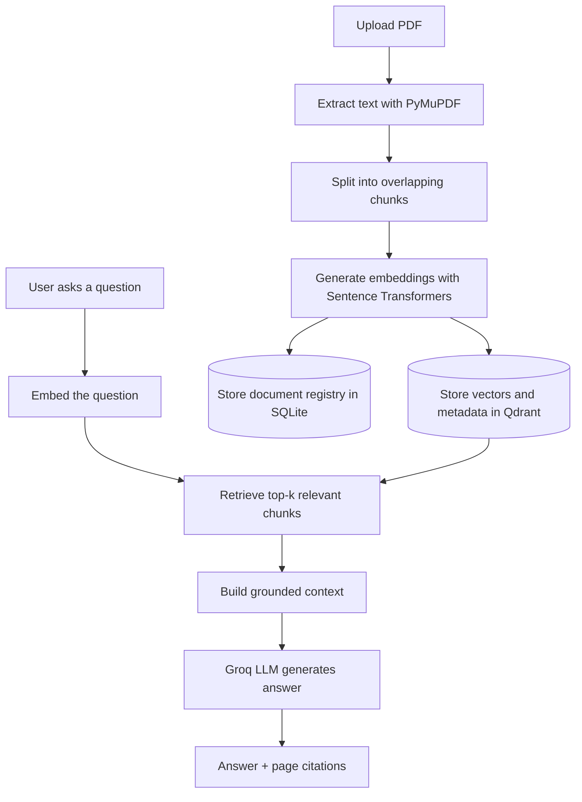

# Papertrail — AI Research & Document Intelligence

> Turn a folder of PDFs into a searchable research assistant. Upload papers, ask natural-language questions, and inspect the source pages behind the answer.


## Overview

Papertrail is a full-stack, local-first Retrieval-Augmented Generation (RAG) application for research papers and PDF knowledge bases.

Instead of sending an entire document to an LLM, the system extracts and chunks the PDF, creates local embeddings, retrieves relevant passages for each question, and asks the language model to answer using that retrieved context. The response includes source metadata so users can trace claims back to document pages.

**What you can do**
- Upload and index text-based PDF documents.
- Ask questions across all indexed documents or a selected subset.
- Retrieve semantically relevant passages from Qdrant.
- Generate answers using Groq's OpenAI-compatible API.
- Inspect citations with filename, page number, and source quote.
- Keep document metadata in SQLite and vector data on local disk.
- Use the included browser UI or the FastAPI Swagger interface.

## Product preview

The app includes a clean research workspace with:
- A PDF upload and knowledge-library panel.
- An indexed-document list with page and chunk counts.
- A document selector to scope each question.
- An answer panel with grounding status and page-level citations.

Run the application and open `http://127.0.0.1:8000` to use the UI.

## Workflow



## Architecture

| Layer | Technology | Responsibility |
|---|---|---|
| Web/API | FastAPI | REST endpoints and browser UI |
| PDF extraction | PyMuPDF | Extract text and page numbers |
| Chunking | Custom Python | Split text with configurable overlap |
| Embeddings | Sentence Transformers | Local semantic vector generation |
| Vector database | Qdrant local mode | Store and retrieve document chunks |
| Metadata database | SQLite | Track uploaded documents |
| LLM | Groq API | Generate answers from retrieved context |
| Validation | Pydantic | Validate API request/response data |
| Testing | Pytest | Test chunking and retrieval metrics |

## RAG pipeline, step by step

1. **Ingestion:** The API accepts a PDF and validates its type and configured size limit.
2. **Extraction:** PyMuPDF extracts text page by page while preserving page references.
3. **Chunking:** Text is split into overlapping chunks to preserve context across boundaries.
4. **Embedding:** Sentence Transformers converts each chunk into a dense vector locally.
5. **Indexing:** Qdrant stores vectors and chunk metadata; SQLite stores the document registry.
6. **Retrieval:** A question is embedded and the most relevant chunks are retrieved, optionally scoped to selected document IDs.
7. **Context construction:** Retrieved passages are assembled within a configurable context budget.
8. **Generation:** Groq generates an answer using the retrieved context and citation instructions.
9. **Response:** The API returns the answer, citation candidates, number of retrieved chunks, and grounding indicator.

## Repository structure

```text
.
├── app/
│   ├── api/routes/       # Upload, list, delete and ask endpoints
│   ├── core/             # Environment-based configuration
│   ├── db/               # SQLite document registry
│   ├── evaluation/       # Retrieval evaluation metrics
│   ├── ingestion/        # PDF extraction and chunking
│   ├── retrieval/        # Embeddings and Qdrant operations
│   ├── schemas/          # Pydantic API schemas
│   └── services/         # Ingestion, retrieval and answer orchestration
├── data/                 # Local runtime data (ignored by Git)
├── scripts/              # Sample PDF utility
├── tests/                # Unit tests
├── ui/                   # Browser-based research workspace
├── .env.example
├── .gitignore
├── Dockerfile
├── docker-compose.yml
├── Makefile
└── requirements.txt
```

## Quick start

### 1. Clone the repository

```bash
git clone https://github.com/<your-username>/ai-research-document-intelligence.git
cd ai-research-document-intelligence
```

### 2. Create and activate a virtual environment

```bash
python -m venv .venv

# Linux / macOS
source .venv/bin/activate

# Windows PowerShell
# .venv\Scripts\Activate.ps1
```

### 3. Install dependencies

```bash
pip install --upgrade pip
pip install -r requirements.txt
```

### 4. Configure environment variables

```bash
cp .env.example .env
```

Add your Groq API key to `.env`:

```env
GROQ_API_KEY=your_groq_api_key_here
```

The embedding model is downloaded locally on first use. No separate embedding API key is required.

### 5. Start the application

```bash
uvicorn app.main:app --reload
```

Open:
- **Web UI:** http://127.0.0.1:8000
- **Swagger API docs:** http://127.0.0.1:8000/docs
- **Health check:** http://127.0.0.1:8000/health

## API reference

| Method | Endpoint | Purpose |
|---|---|---|
| `GET` | `/health` | Check service health |
| `POST` | `/documents/upload` | Upload and index a PDF |
| `GET` | `/documents` | List indexed documents |
| `GET` | `/documents/{document_id}` | See API docs for available document operations |
| `DELETE` | `/documents/{document_id}` | Delete a document |
| `POST` | `/ask` | Ask a question over selected documents |

Example question request:

```json
{
  "question": "What are the main findings of the paper?",
  "user_id": "demo-user",
  "document_ids": ["document-id-from-upload"]
}
```

Example response shape:

```json
{
  "answer": "The paper reports ...",
  "citations": [
    {
      "document_id": "document-id",
      "filename": "research-paper.pdf",
      "page": 4,
      "chunk_id": "chunk-id",
      "quote": "Relevant extracted passage..."
    }
  ],
  "retrieved_chunks": 5,
  "grounded": true
}
```

Exact answer and citation content depend on the uploaded PDF and retrieval results.

## Configuration

The application reads settings from `.env`. See `.env.example` for the full list.

| Variable | Purpose |
|---|---|
| `GROQ_API_KEY` | API key for answer generation |
| `GROQ_BASE_URL` | Groq OpenAI-compatible API base URL |
| `LLM_MODEL` | Chat model identifier |
| `EMBEDDING_MODEL` | Local Sentence Transformers model |
| `QDRANT_PATH` | Local Qdrant persistence directory |
| `SQLITE_PATH` | SQLite database path |
| `MAX_UPLOAD_MB` | Maximum accepted PDF size |
| `CHUNK_SIZE` / `CHUNK_OVERLAP` | Chunking configuration |
| `RETRIEVAL_TOP_K` | Number of passages to retrieve |
| `RETRIEVAL_SCORE_THRESHOLD` | Minimum retrieval score |
| `MAX_CONTEXT_CHARS` | Maximum context passed to the LLM |

## Evaluation and tests

The project includes retrieval metric utilities for:
- **Recall@K:** Whether relevant chunks appear in the top-K retrieved results.
- **MRR:** How highly the first relevant result is ranked.
- **Citation coverage:** Whether an answer includes citation references.

Run the tests:

```bash
pytest -q
```

These metric utilities are building blocks; they do not imply that a complete benchmark has been run against a research dataset.

## Design decisions

- **Local embeddings:** Avoids sending document text to a separate embedding provider.
- **Separate vector and metadata stores:** Qdrant handles semantic retrieval; SQLite tracks document records.
- **Page-aware chunks:** Makes it possible to trace retrieved content to its original PDF page.
- **Document-scoped retrieval:** Lets a user constrain a question to selected files.
- **Provider-independent API shape:** Groq is accessed through an OpenAI-compatible client interface.

## Current limitations

This is a portfolio and learning project, not a production-hardened multi-tenant service.

- Supports text-based PDFs; scanned PDFs require OCR, which is not included.
- Uses dense vector retrieval; hybrid BM25 search and reranking are not included.
- Citation references point to retrieved passages, but generated claims still require human verification.
- The sample `user_id` is a demo scope, not authentication or authorization.
- Local Qdrant persistence is intended for a single application process.
- Original PDF files are processed during upload and are not retained as a document download library.
- Conversation history and multi-turn chat memory are not implemented.
- No benchmark results are claimed; evaluation helpers and unit tests are included.

## Security notes

- Never commit `.env` or API keys.
- Local `data/` files are excluded from Git.
- Add authentication, authorization, rate limiting, upload malware scanning, and tenant isolation before exposing this service publicly.
- Review generated answers against the cited source material before relying on them.

## Roadmap

- OCR for scanned PDFs.
- Hybrid keyword + vector retrieval.
- Cross-encoder reranking.
- Streaming answers and multi-turn conversation memory.
- Background ingestion jobs and document processing status.
- Authentication and multi-user access controls.
- Automated RAG evaluation with a curated question/answer dataset.
- Deployment configuration for a managed vector database.

## License

This project is released under the MIT License. Add a `LICENSE` file if you intend to distribute it under that license.

---

**Built as a hands-on exploration of LLM application engineering, document ingestion, vector search, and grounded question answering.**
# Papertrail-AI
